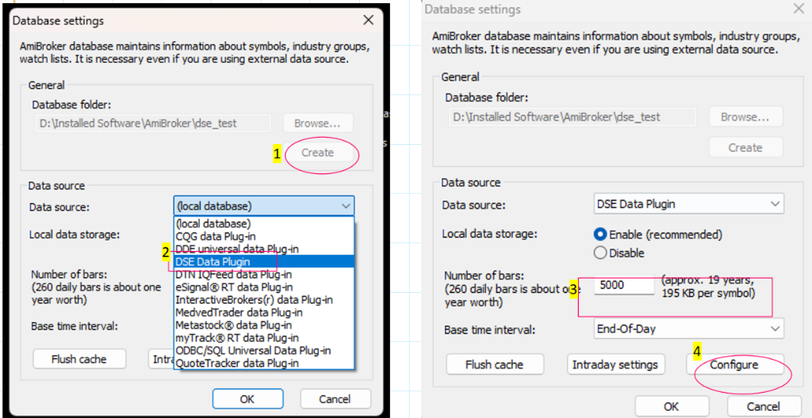
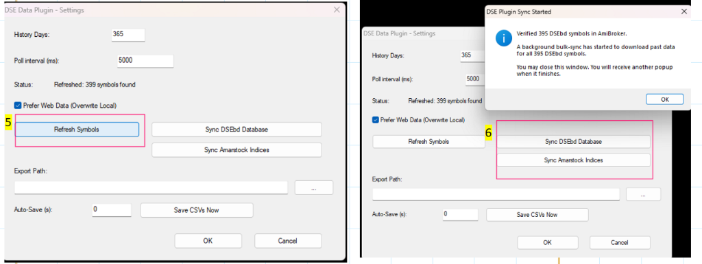
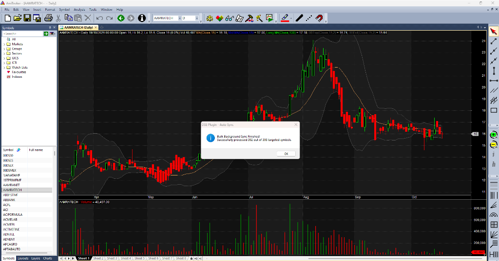
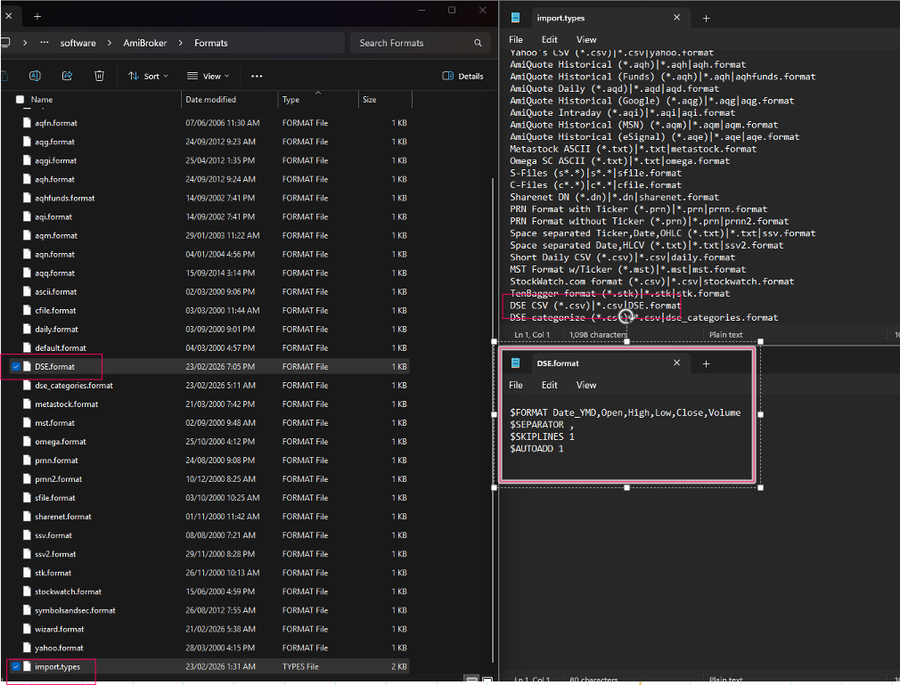

# 🇧🇩 AmiBroker DSE Data Plugin

A high-performance native C++ data plugin for [AmiBroker](https://www.amibroker.com/) that fetches historical OHLCV bars and real-time streaming prices for the **Dhaka Stock Exchange (DSE)** and **Amarstock Market Indices**.

**Zero external dependencies** — built with native Windows WinInet and Win32 APIs. No Python, no curl, no `requests`. Compatible with both **32-bit (x86)** and **64-bit (x64)** AmiBroker.

---

## ✨ Features

- **Reliable Historical Backfill** — Auto-fetches OHLCV history with smart DSE archive date clamping (~2 years rolling web limit) seamlessly merged with unlimited local CSV seed history.
- **Real-Time Streaming Feed** — Live background polling for LTP, High, Low, YCP, and Volume during market hours (Sun–Thu, 10:00–14:30 BST), with off-market quote preservation for evening chart analysis.
- **Bounded Worker Queue** — Single throttled background worker queue eliminates thread explosions, UI freezes, and socket exhaustion during bulk scans or exploration runs.
- **Broad Market Indices** — Built-in support for all 4 Amarstock indices (`00DSEX` / `DSEX`, `00DS30` / `DS30`, `00DSES` / `DSES`, `00DSMEX` / `DSMEX`).
- **Resilient Network Layer** — Dynamic HTTP/HTTPS detection with automatic SSL/TLS certificate verification retries.
- **Modern Clean UI Dialog** — Programmatic Win32 configuration dialog rendered with native modern Windows GUI fonts and one-click bulk sync buttons.
- **Thread-Safe Architecture** — Fully synchronized quotes cache, thread-local AmiBroker return structures, and event-driven shutdown eliminating hangs.

---

## 🚀 Installation & Setup

### 1. Copy the Plugin DLL
Download the DLL from [GitHub Releases](https://github.com/rahathasan452/AmiBroker_DSE_plugin/releases) (or find it in `build\Release\` if building from source):
- **For 32-bit AmiBroker** (most common):
  Copy `DSE_DataPlugin_x86.dll` to:
  `C:\Program Files (x86)\AmiBroker\Plugins\DSE_DataPlugin.dll`
- **For 64-bit AmiBroker**:
  Copy `DSE_DataPlugin_x64.dll` to:
  `C:\Program Files\AmiBroker\Plugins\DSE_DataPlugin.dll`

### 2. Copy the Configuration File (Optional)
> **Note:** This step is **optional**. The plugin has built-in safe defaults and runs automatically without this file.
Copy `config\dse_config.ini` to the `Plugins\config\` directory only if you wish to customize endpoints, polling intervals, or logging:
`C:\Program Files (x86)\AmiBroker\Plugins\config\dse_config.ini`

---

### 3. Configure Database in AmiBroker

1. Open AmiBroker.
2. Go to **File** → **New** → **Database**.
3. Choose a folder for your database (e.g., `D:\Installed Software\AmiBroker\dse_test`) and click **`Create`** **(1)**.
4. Under **Data source**, select **`DSE Data Plugin`** **(2)**.
5. Set **Local data storage** to **Enable (recommended)** and set **Number of bars** to **`5000`** (approx. 19 years) or higher **(3)**. Set **Base time interval** to **End-Of-Day**.
6. Click **`Configure`** **(4)**.



---

### 4. Sync Symbols & Historical Data

1. In the **DSE Data Plugin - Settings** dialog, click **`Refresh Symbols`** **(5)** to discover all active tickers from DSE.
2. Click **`Sync DSEbd Database`** **(6)** to verify all 395+ DSE symbols and start the background bulk download of historical data.
3. Click **`Sync Amarstock Indices`** **(6)** to register `00DSEX`, `00DS30`, `00DSES`, and `00DSMEX`.



---

### 5. Sync Complete & Real-Time Charting

When the bulk background download finishes, AmiBroker displays a completion notification:
> *"Bulk Background Sync Finished! Successfully processed 392 out of 395 targeted symbols."*

All symbols are now listed in your left Symbol tree (AAMRANET, AAMRATECH, GP, etc.). Clicking any ticker renders the chart instantly with technical indicators and live quotes.



---

## ⚠️ DSE Historical Data Archive Disclaimer

> [!IMPORTANT]
> **DSE 2-Year Rolling Web Archive Limit:**
> The official Dhaka Stock Exchange website (`old.dsebd.org/day_end_archive.php`) only maintains a rolling archive of the past **2 years** of historical data. Requests for dates older than 2 years return *"No Day End Data"*.
> 
> The plugin automatically handles this by clamping web requests to DSE's maximum 2-year window. **If you need more than 2 years of history (e.g. 5 to 20+ years)**, upload the past data manually using AmiBroker's **Import ASCII** feature as described below.

---

## 📥 How to Upload DSE Past Data Manually Through Import ASCII

You can import multi-year historical CSV files into AmiBroker in just a few clicks using AmiBroker's built-in ASCII importer.



### Step 1: Copy Format Files to AmiBroker
Copy the format definitions from this repository's `formats\` folder to your AmiBroker `Formats\` directory:
- Source: `formats\dse.format` and `formats\dse_categories.format`
- Destination: `C:\Program Files (x86)\AmiBroker\Formats\`

### Step 2: Configure `import.types`
To make the format appear in AmiBroker's **Import ASCII** drop-down box:
1. Open the file `import.types` located in your AmiBroker `Formats\` folder using Notepad (e.g., `C:\Program Files (x86)\AmiBroker\Formats\import.types`).
2. Add the following lines:
   ```text
   DSE CSV (*.csv)|*.csv|dse.format
   DSE categorize (*.csv)|*.csv|dse_categories.format
   ```
3. Save and close `import.types`.

### Step 3: Format Specification (`dse.format`)
The included `formats\dse.format` specifies:
```ini
$FORMAT Date_YMD,Open,High,Low,Close,Volume
$SEPARATOR ,
$SKIPLINES 1
$AUTOADD 1
```
*(If your CSV file includes a Ticker column first, use `$FORMAT Ticker,Date_YMD,Open,High,Low,Close,Volume`)*.

### Step 4: Import Historical CSVs
1. In AmiBroker, go to **File** → **Import ASCII...**
2. In the **Files of type** dropdown, select **`DSE CSV (*.csv)`**.
3. Select your historical CSV file(s) and click **Open**.
4. AmiBroker will import all historical bars into your database. The DSE Data Plugin will then automatically append fresh web data and live quotes on top of this imported history!

---

## ⚙️ Configuration (Optional)

To customize behavior, download `dse_config.ini` from [GitHub Releases](https://github.com/rahathasan452/AmiBroker_DSE_plugin/releases) or use `config\dse_config.ini` from this repository:

| Section | Key | Default | Description |
|---|---|---|---|
| `[Settings]` | `HistoryDays` | `365` | Days of history to fetch on first symbol load |
| `[General]` | `PollIntervalMs` | `5000` | Real-time polling interval in milliseconds (min 1000) |
| `[General]` | `MarketOpenHour` | `10` | DSE session open hour (BST = UTC+6) |
| `[General]` | `MarketCloseHour` | `14` | DSE session close hour |
| `[General]` | `MaxReconnectAttempts` | `10` | Max retries before pausing for 60 seconds |
| `[General]` | `PreferWebData` | `1` | `1` = web overwrites local CSV; `0` = local CSV seed takes priority |
| `[DataSource]` | `CsvSeedPath` | | Folder with per-symbol CSV seed files (e.g. `GP.csv`). Leave empty for web-only. |
| `[Export]` | `ExportPath` | | Folder to auto-export cached CSV data. |
| `[Debug]` | `EnableLogging` | `1` | Set to `1` to write debug logs to `LogFilePath`. |
| `[Debug]` | `LogFilePath` | `dse_plugin.log` | Path for the debug log file. |

---

## 🔨 Building from Source

### Quick Build (Visual Studio 2022)
Open Command Prompt and run:
```cmd
build_manual.bat --no-pause
```
Produces both `build\Release\x86\DSE_DataPlugin_x86.dll` and `build\Release\x64\DSE_DataPlugin_x64.dll`.

### CMake Build
```powershell
# 32-bit (x86)
cmake -B build -G "Visual Studio 17 2022" -A Win32
cmake --build build --config Release

# 64-bit (x64)
cmake -B build -G "Visual Studio 17 2022" -A x64
cmake --build build --config Release
```
